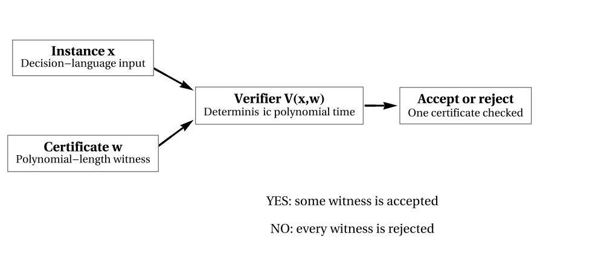

# C04 — Verification, Certificates, and NP

**Status:** Reviewed editorial candidate; corrections from CDA-REV-C04-002 applied; publication acceptance pending.  
**Prerequisites:** C01 problem formulations, C02 asymptotics, C03 deterministic polynomial time.

## Question: can a difficult answer be easy to check?

Imagine a maze. Finding a route to the exit may take a long search, but checking a proposed route is straightforward: follow each step and confirm that it crosses an open corridor. Boolean satisfiability has a similar pattern. Finding satisfying truth values might require exploration, but checking an assignment means evaluating the given formula.

This distinction inspires **NP**. It is tempting to jump to “checking is always easier than finding.” Complexity theory does not license that claim in general. Instead, it provides a precise way to ask whether **yes-instances admit polynomially short certificates that can be verified in polynomial time**.

## Section 1 — A language and a verifier

Recall from C01 that a decision problem is represented by a language $L\subseteq\{0,1\}^*$. A string $x$ is a **yes-instance** when $x\in L$ and a **no-instance** otherwise. We seek a deterministic algorithm $V$ taking a pair $(x,w)$, where $w$ is a claimed witness.

**Definition.** A language $L$ belongs to $NP$ if there are a polynomial $p$ and a deterministic polynomial-time predicate $V$ such that

$$
x\in L\iff \exists w\in\{0,1\}^*,\quad
|w|\le p(|x|)\ \text{and}\ V(x,w)=1.
$$

The right-to-left implication is **soundness**: no witness should fool the verifier into accepting a no-instance. The left-to-right implication is **completeness**: every yes-instance has at least one accepted witness.

Two polynomial bounds matter. The witness itself must have length at most $p(|x|)$, and the deterministic verifier runs in polynomial time in $|x|+|w|$. The former makes the latter polynomial in the original input length. Merely saying that a certificate is “checkable in finite time” is not enough.

## Section 2 — SAT as the archetype

A Boolean formula is formed from variables and logical connectives such as $\lor$, $\land$, and $\neg$. **SAT** asks whether some assignment of truth values makes the formula true.

Take the formula

$$
\varphi=(a\lor b)\land(\neg a\lor c)\land(\neg b\lor\neg c).
$$

Consider the witness $a=1,b=0,c=1$. The three clauses evaluate to $1$, $1$, and $1$, so the verifier accepts. A proposed witness can be represented by one bit per variable, with a canonical variable ordering. Its length is at most linear in the number of variable names occurring in the encoded formula, itself bounded by the encoding length.

A verifier checks that the assignment gives a value to each variable and evaluates the formula recursively or clause by clause. This requires at most polynomial time in the written formula length. The verifier need not know how to *find* a satisfying assignment; it merely checks one.

Now consider $(a)\land(\neg a)$. Every assignment fails at least one clause, so no witness will make the verifier accept. NP's definition does not demand that this particular verifier supply a short certificate of unsatisfiability. Verifying **no** answers belongs to a distinct discussion of complements (C07).

## Section 3 — Two further anchor problems

**Hamiltonian cycle.** An instance is a finite graph $G=(V,E)$. The question is whether a simple cycle visits every vertex exactly once. A witness lists the vertices in cyclic order. The verifier checks (i) that the list contains exactly $|V|$ vertices, (ii) that each appears once, and (iii) that every consecutive pair—including last to first—is an edge. These operations are polynomial in the encoded graph size. If the graph has a Hamiltonian cycle, a witness exists; otherwise, none passes.

**Decision traveling salesperson.** An instance consists of an appropriately encoded weighted graph and a budget $B$. A witness is a tour. The verifier checks the tour and adds encoded edge weights, accepting if the total is at most $B$. Integer addition and comparison can be performed in polynomial time in the bit lengths of the numbers. This argument establishes NP **membership**, not NP-completeness. Hardness is a further claim about reductions (C05).

## Section 4 — The fundamental containment

**Theorem.** $P\subseteq NP$.

**Proof.** Suppose a deterministic polynomial-time algorithm $D$ decides $L$. Define a verifier by $V(x,w)=D(x)$, independent of $w$, and choose the empty witness. If $x\in L$, the empty witness causes acceptance; if $x\notin L$, no witness can cause acceptance. The verifier runs in polynomial time. Hence $L\in NP$. $\square$

We **do not know** whether $P\subsetneq NP$, or equivalently whether $P=NP$. Showing that some problems have a familiar “easy to check, hard to find” appearance is not a proof of strict separation.

## Section 5 — Why the word nondeterministic?

NP abbreviates **nondeterministic polynomial time**, not “non-polynomial.” One standard machine model allows a computation to branch into different choices, accepting an input if at least one branch accepts within polynomially many steps. The imagined branching is a mathematical definition of computational power; it is not ordinary randomized computation and does not mean a physical processor explores infinitely many paths at once.

The witness-verifier characterization and the nondeterministic-machine characterization are equivalent, under standard encodings.

*Sketch, witnesses to branches.* A nondeterministic machine can guess the at-most-polynomial-length witness one bit at a time and then execute $V$. A yes-instance has some accepting branch exactly when a valid witness exists.

*Sketch, branches to witnesses.* If a nondeterministic machine accepts within $p(n)$ steps, describe the finite sequence of nondeterministic choices taken on one accepting branch. A deterministic simulator can replay those choices and check acceptance in polynomial time. This sequence is a polynomial-length certificate.

Thus the verifier model is not merely a metaphor; it captures the computational meaning of nondeterminism.

## Section 6 — Membership is not hardness

The statement “SAT belongs to NP” follows from its efficient assignment verifier. The statement “SAT is NP-complete” contains *another* theorem: SAT is at least as difficult, under a specified polynomial-time reduction, as every language in NP. The second component is the Cook–Levin result, explored after reductions in C05–C06.

It follows that one cannot say “all problems in NP are hard” or “this problem has a certificate, so it is NP-complete.” Polynomial-time problems themselves are in NP, by the theorem just proved.

Integer factorization offers the same warning. Discovering a nontrivial divisor and checking that a reported divisor divides $N$ are distinct actions. Efficiently verifying a divisor does not make factorization NP-complete. The precise formulations and the distinction between function and decision tasks remain important.

## Section 7 — Common mistakes

**“NP means non-polynomial.”** False: its historical and technical meaning is *nondeterministic polynomial time*.

**“The verifier finds the witness.”** No: the verifier receives $w$ as part of its input. Search is a different algorithmic task.

**“One acceptable witness proves both yes and no instances.”** No: the existential witness convention establishes **yes** membership. Unsatisfiability cannot be certified merely by failing to find an assignment.

**“A beautiful certificate of exponential length is good enough for NP.”** Not unless the particular problem also has polynomial-length certificates as required by the definition.

**“P is a smaller circle than NP.”** The inclusion is established, but drawing visibly separate boundaries can misleadingly suggest $P\ne NP$, which is unresolved.

## Exercises

1. Write a Hamiltonian-cycle verifier in pseudocode. Bound witness size and verification runtime in terms of the graph encoding length.
2. Evaluate the three-clause formula above under $a=0,b=1,c=0$. Does it satisfy all clauses? Show each clause's value.
3. Explain why an exponentially long trace of a computation might be easy to check in its own length but does not automatically witness NP membership.
4. Prove $P\subseteq NP$ without using any diagram.
5. Explain the gap between “decision TSP is in NP” and “decision TSP is NP-complete.”
6. Why does an accepting nondeterministic computation path have a polynomial-length representation when the machine's running time is polynomial?

*Figure F3.2 (unreviewed candidate).* Checking a proposed yes-certificate is not the same as finding it; see [the scoped mathematical caption](../figures/F3_2_CAPTION.md).

## Further reading

Stephen A. Cook, *The Complexity of Theorem-Proving Procedures* (1971), [DOI:10.1145/800157.805047](https://doi.org/10.1145/800157.805047), established foundational completeness results. Its original historical formulation must not be confused with a literal proof here of every modern SAT many-one reduction.

## Map update

The Atlas acquires the **yes-certificate axis**: a language may be easy to verify under bounded witnesses without a known fast discovery algorithm. The proved map includes $P\subseteq NP$, with equality or strictness explicitly unresolved.

**Available illustrated component:** F3.2 depicts the certificate/verifier mechanism with explicit soundness/completeness scope. A distinct P-versus-NP relation diagram is not yet accepted; it must not be implied by the existence of F3.2.

**Exit test:** State NP formally with its two polynomial requirements, verify the SAT example, and distinguish NP membership from NP-completeness.
