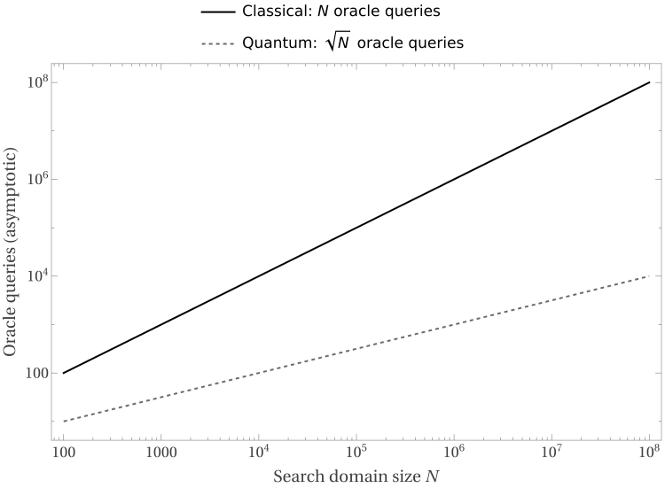

# C15 — Quantum Computation: What Changes When the Machine Changes?

**Status:** Expanded manuscript candidate; independent mathematical and pedagogical review pending.  
**Prerequisites:** Problem formulations (C01), bounded verification (C04), and reductions (C05).

## Question: which computations become easier with quantum operations?

A quantum computer is not a conventional processor with permission to inspect exponentially many possible answers simultaneously. Instead, it creates and transforms a state whose complex-valued **probability amplitudes** can interfere. Measurement produces a classical outcome drawn from the resulting probability distribution. The algorithmic art is arranging interference to make useful results sufficiently probable.

We should ask a precise question: *for which specified tasks and resource measures does the quantum model provide provably better algorithms?* The answer depends on whether we count gates, time, queries to an oracle, or implementation cost.

## 1. A minimal quantum model

A single qubit has state \(\alpha|0\rangle+\beta|1\rangle\), where \(\alpha,\beta\in\mathbb C\) and \(|\alpha|^2+|\beta|^2=1\). Measuring in the computational basis gives 0 or 1 with these squared magnitudes as probabilities. A register of \(m\) qubits has \(2^m\) basis states. This **does not** mean a measurement reveals \(2^m\) independently readable values.

Quantum gates act by unitary transformations and preserve total probability. A circuit uses a sequence of local gates and measurements. We assume a standard finite universal gate set and **uniform** circuit families: a deterministic classical procedure, given the input length \(n\), produces the \(n\)-bit circuit description in polynomial time. This uniformity requirement prevents a different, arbitrarily powerful circuit from being smuggled into each input length.

## 2. BQP is a decision class

A language \(L\subseteq\{0,1\}^*\) lies in \(BQP\) if a uniform family of polynomial-size quantum circuits, on input \(x\), outputs 1 with probability at least \(2/3\) if \(x\in L\) and at most \(1/3\) if \(x\notin L\).

The thresholds \(2/3\) and \(1/3\) are conventional. Running independent copies and taking a majority vote drives the error down exponentially in the number of repetitions, with only polynomial additional cost. An algorithm with a yes/no output and bounded error is thus different from one that returns an exact proof certificate.

**Theorem.** \(P\subseteq BQP\). A reversible quantum circuit can simulate a deterministic polynomial-time classical algorithm with polynomial overhead, preserving its final answer. The proof does not show \(P\subsetneq BQP\): that strictness is unresolved.

## 3. The factoring trajectory

Given a positive integer \(N\), encoded in binary, the **search/function** task is to output its prime factors with multiplicity. This task differs from asking whether an integer has a factor in a specified range, or from a promise problem about a special family of integers.

Shor's factoring method combines a classical reduction of factoring to order finding with a quantum subroutine implementing period finding. The relevant cyclic behavior is that powers of a number repeat modulo \(N\). Quantum interference lets the period-finding circuit produce data from which a classical continued-fraction calculation can often recover the period; repeated randomized choices supply success with high probability.

This gives a polynomial-time quantum algorithm in the bit length \(\log N\), under the usual idealized computational model. It does **not** establish an unconditional exponential quantum-versus-classical separation for factoring, because no theorem rules out an unknown classical polynomial-time factoring algorithm.

Most importantly, **integer factoring is not known NP-complete**. Its efficient quantum solution therefore supplies no proof that quantum computers efficiently solve SAT or every other NP-complete problem. This is the distinction between a dramatic algorithm for a particular task and a containment theorem for an entire complexity class.

## 4. Grover's search: an oracle lesson

Suppose there are \(N\) possible candidates and an oracle can test whether a candidate is marked. If the database is unstructured and exactly one entry is marked, classical bounded-error randomized search requires \(\Theta(N)\) queries. Grover's amplitude-amplification method finds the marked entry using \(O(\sqrt N)\) oracle queries, and the quadratic improvement is asymptotically optimal in the standard black-box query model.

Why only a square root? Grover repeatedly performs two reflections, rotating the state toward the marked component. After roughly a constant times \(\sqrt N\) iterations, the marked state has high measurement probability. Repeating beyond the optimum can rotate *away* from it.

**Numerical intuition.** For \(N=10^6\), linear scaling suggests order \(10^6\) oracle calls, while square-root scaling suggests order \(10^3\). These are asymptotic expressions with suppressed constants—not measured wall-clock times. The physical cost of implementing the quantum oracle may eliminate or reduce a practical advantage. Nor can we infer an efficient generic SAT algorithm: enumerating assignments would require search over \(N=2^n\) candidates, and \(O(\sqrt N)=O(2^{n/2})\) remains exponential in \(n\).

That calculation is central. A quadratic improvement in the **search-space size** \(N\) can still leave an exponential complexity in the **encoded input size** \(n\).

*Figure F15.1 (review candidate).* Black-box query complexity, **not measured hardware runtime**. The distinct line styles survive grayscale. See [caption and scope](../figures/F15_1_CAPTION.md).

## 5. What the map can show

Established: \(P\subseteq BQP\); factoring and discrete logarithms admit polynomial-time quantum algorithms; black-box unstructured search admits a quadratic quantum query advantage.

Not established: \(NP\subseteq BQP\); \(BQP\subseteq NP\); equality or strict separation between \(NP\) and \(BQP\). A picture must not place NP and BQP as nested or disjoint regions unless it clearly distinguishes an illustrative hypothesis from a proved theorem.

We can introduce **QMA** as optional depth: like NP, it has a witness-verifier viewpoint, but the witness and verifier are quantum, with completeness/soundness thresholds. Quantum witnesses cannot simply be copied and inspected like classical strings. Detailed QMA completeness lies beyond this chapter.

## 6. Common mistakes

**“A quantum computer tries all solutions and reads out the best.”** This ignores the measurement bottleneck and the role of interference.

**“Grover makes exponential search polynomial.”** For \(N=2^n\), square-root search still uses exponentially many oracle queries in \(n\).

**“Shor proves NP-complete problems are easy on quantum machines.”** It proves an algorithmic upper bound for specific number-theoretic problems, not a universal complexity-class containment.

**“BQP describes every task a quantum computer can do.”** BQP is a bounded-error **decision** class; search and function tasks require appropriately stated quantum function/search complexity notions.

## Exercises

1. In the computational basis, what probabilities result from measuring \((|0\rangle+|1\rangle)/\sqrt2\)? Why does one measurement not reveal both basis states?
2. Compare \(N\) and \(\sqrt N\) for \(N=10^4,10^6,10^8\). State exactly which resource the two functions count.
3. Substitute \(N=2^n\) into \(\sqrt N\). Is the result polynomial in \(n\)? Explain why this matters for brute-force SAT search.
4. Give a precise decision-language formulation related to factoring, and explain why it is not identical to outputting a complete prime factorization.
5. Diagnose the unsupported inference: “Factoring has a fast quantum algorithm, therefore NP-complete SAT has a fast quantum algorithm.”
6. Explain why a plot of BQP and NP as two non-overlapping blobs would make an unjustified mathematical claim.

## Map update

The map acquires a **machine-model coordinate** as well as time, space, and answer type. A change of computational model can alter known upper bounds without resolving all relationships between major complexity classes.

**Figure requirement.** F15.1 plots \(N\) and \(\sqrt N\) for *black-box query complexity*, with Wolfram source retained and publication export still to be inspected. It must state that these are asymptotic comparisons, not real-device performance benchmarks. A separate class relationship figure must explicitly mark the unknown \(NP\)-\(BQP\) relationship.

**Exit test.** Explain why Grover's improvement remains exponential on a \(2^n\)-sized search space, why factoring is an important quantum algorithmic success, and why neither result proves efficient quantum solutions to NP-complete problems.
