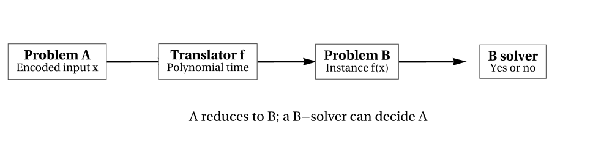

# New keystone figure candidates — editorial preview

**Status:** Unaccepted vector figures. These are source-linked candidate images, **not** finished publication graphics. The manuscript targets in PR #6/#7 are immutable pending review.

## F2.1 — A reduction is an executable translation

[Read the full caption and limitations](F2_1_CAPTION.md). This picture represents a valid polynomial-time many-one reduction's direction; it does not prove a specific named problem is hard or complete.

## F6.2 — The halting problem's diagonal contradiction

[Read the full caption and limitations](F6_2_CAPTION.md). The imagined procedure is a contradiction hypothesis, not an executable universal predictor.

## Editorial acceptance obligations

At intended page width, inspect minimum font size, box clearance, arrows, grayscale readability and accessibility. Confirm source reproduction in a Wolfram kernel and independent mathematical semantics. These source files do not update a frozen manuscript review head.
