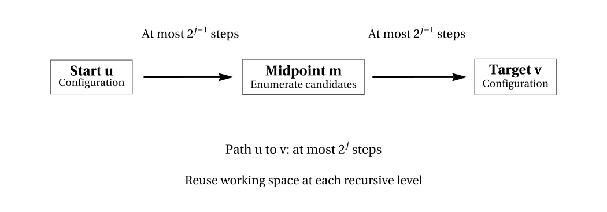

# F3.2 and F4.3 — additional keystone vector figures

**Status:** Unreviewed Wolfram SVG candidates, not accepted publication artifacts. Frozen chapter PR #7 is unchanged.

## F3.2 — NP verifier with yes-witness and no-instance conditions

[Mathematical caption and accessibility scope](F3_2_CAPTION.md)

## F4.3 — Savitch bounded reachability via midpoint

[Mathematical caption and accessibility scope](F4_3_CAPTION.md)

Both figures use monochrome vector shapes with Wolfram-outlined mathematical typography. They require independent theorem-scope review, final-width inspection, and exact source regeneration before publication.
